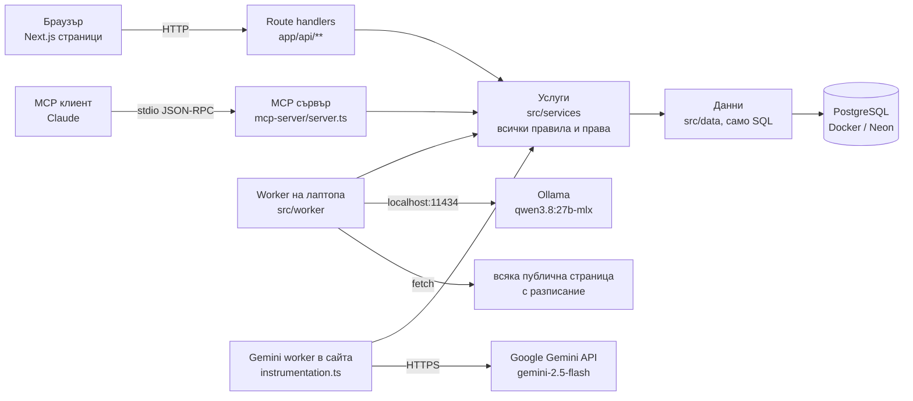
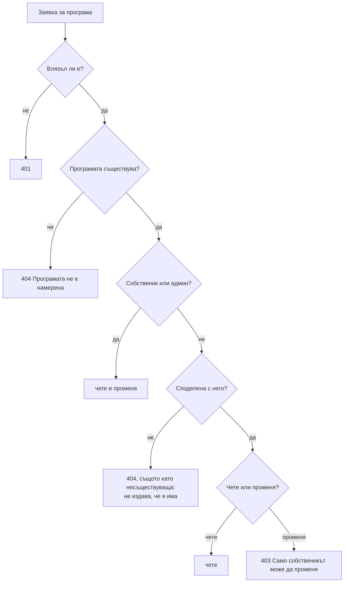
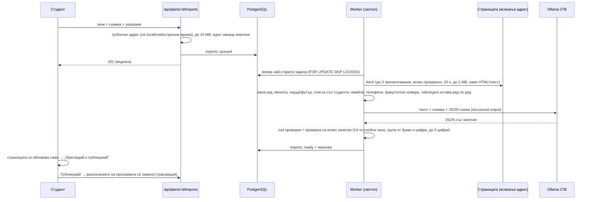
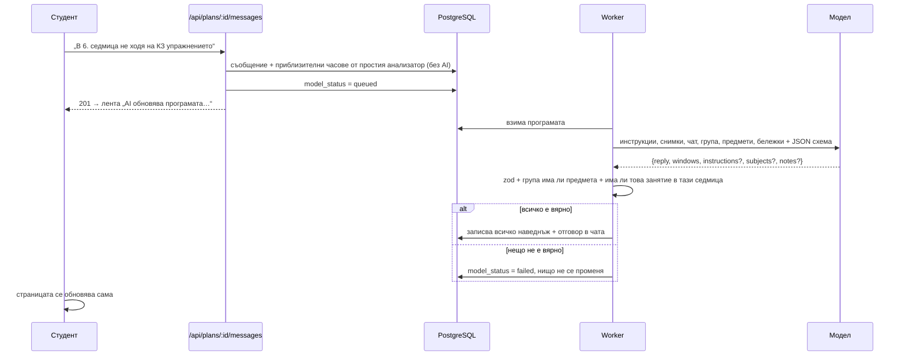
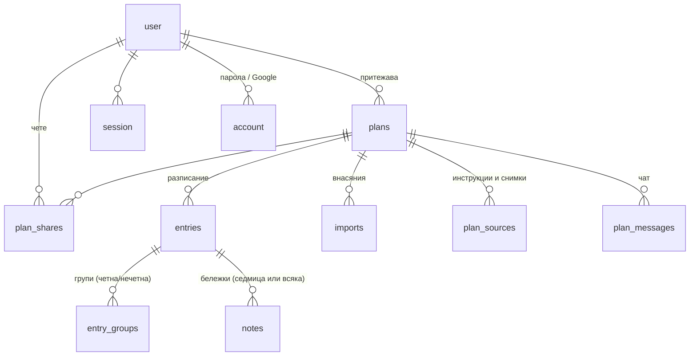

# ТУ Програма: ръководство

Всичко на едно място: какво е приложението, как работи (с диаграми), какъв AI използва и до какво има достъп,
MCP, CI, как се пуска и спира, демо сценарий с всички функции и кое изискване от упражненията къде е покрито.

> Диаграмите са Mermaid. GitHub ги рисува сам; във VS Code трябва разширението
> „Markdown Preview Mermaid Support“, после `Cmd+Shift+V`.

---

## 1. Какво прави

Всеки студент си прави собствена седмична програма:

1. **Разписание:** внася го от линк към страницата на факултета, от снимка или от двете. AI го чете, студентът
   преглежда черновата и я публикува. Може и копие на примерното разписание на ФКСТ КСИ.
2. **Група и предмети:** избира групата си, а за всеки предмет с коя група ходи или „Не го взимам“.
3. **Чат с AI:** казва кога е зает („Работя от 9 до 16:30“), качва снимка на график, иска промени
   („УП упражнение с 221а“, „в 6. седмица не ходя на КЗ“). AI подрежда програмата.
4. **Календар:** всяко занятие е „Може да присъства“ (зелено), „Трябва отпуска“ (оранжево, упражнение по време
   на работа) или „Пишете на преподавателя“ (червено, лекция по време на работа). Бележки: „Отменено“, „Не ходя“,
   „Контролно“.
5. **Споделяне:** по имейл, само за четене. **Админ** вижда и променя всичко и дава роли.
6. **MCP:** AI асистент (например Claude) вижда седмицата на студента и добавя бележки от негово име.

---

## 2. Как е построено

### 2.1 Частите



- **Правилата са само в `src/services/`.** Страниците, API-то, MCP сървърът и worker-ът минават през едни и същи
  функции. Всяка функция приема първо „кой пита“ (actor) и сама проверява правата.
- **SQL има само в `src/data/`.**
- **Моделът никога не се вика в HTTP заявка.** Заявката записва задача в базата и връща веднага; worker-ът я
  взима, пита модела, проверява отговора и го записва.

### 2.2 Кой какво може (`src/services/access.ts`)



### 2.3 Внасяне на разписание от линк



**Как се изтегля страницата (и защо не Playwright):** линкът може да е към **каквато и да е публична страница**.
Worker-ът я изтегля с обикновен `fetch` (`fetchPage` в `src/services/imports.ts`), JavaScript не се изпълнява:
1. **Проверка на адреса:** само http/https; отказва `localhost`, `127.x`, `10.x`, `192.168.x`, `169.254.x`, `[::1]`,
   `.local` и имена, които в DNS сочат там. Иначе някой би могъл да накара сървъра да отвори нещо вътрешно (например
   моделът на `localhost:11434`).
2. **Изтегляне:** до 3 пренасочвания (всяко проверено наново), 20 s, до 2 MB, само HTML или текст (снимка/PDF → грешка).
3. **Общо почистване** (`pageText`), без да зависи как е направена страницата: маха код, стилове, менюта, хедър и
   футър; клетките на таблица стават `a | b | c`, редовете стават нови редове; маха раздел със списък на студенти
   (заглавие „Списъчен състав“ или id като `ksi-students`), имейли, телефони и факултетни номера; до 50 000 знака.
4. **Моделът** чете текста и сам намира разписанието, каквато и да е подредбата; сървърът проверява всяко занятие, а
   студентът преглежда черновата.

Ограничение: имена, които не са в такъв раздел, може да стигнат до модела. С модела на лаптопа остават на лаптопа; с
Gemini отиват при Google. В отговора на модела имена не може да има (схемата няма такива полета).

### 2.4 Чат



### 2.5 Таблиците в базата



| Таблица | Какво пази |
| --- | --- |
| `user`, `session`, `account`, `verification` | Better Auth: потребители (с `role` student/admin), сесии, парола (scrypt) или Google |
| `plans` | програма: собственик, име, `my_group`, `subjects` (избор на група за предмет), `windows` (заети часове), `windows_from` (AI или анализатор), `model_status` |
| `entries`, `entry_groups` | занятията на разписанието на програмата и групите им (all/odd/even) |
| `notes` | бележки за занятие: за една седмица (`week`) или за всяка (`null`) |
| `imports` | внасяне: линк, снимка (`bytea`), указания, статус, чернова (`jsonb`) |
| `plan_sources` | инструкциите, които AI е записал, и качените снимки (`bytea`, без външно хранилище) |
| `plan_messages` | чатът |
| `plan_shares` | с кого е споделена програмата |
| `schema_migrations` | кои миграции са приложени (`db/migrations/001…006`) |

---

## 3. AI: кой модел, какви настройки, до какво има достъп

| | Основен | Резерв |
| --- | --- | --- |
| Модел | **Qwen3.8-27B** (`qwen3.8:27b-mlx`) през Ollama на лаптопа | **Gemini 2.5 Flash** (`gemini-2.5-flash`) |
| Къде | `http://localhost:11434`, нищо не излиза от лаптопа | Google API; данните отиват при Google (страницата го казва) |
| Кога отговаря | веднага щом има задача | само задача, чакала **30 s** (лаптопът е изключен или зает), и само ако има `GEMINI_API_KEY` |
| „Effort“ | **без мислене** (`think: false`, `MODEL_THINK=false`): ~20 s за цялата страница на факултета, 19/19 верни занятия; чатът ~6–9 s | `temperature: 0` |
| Контекст | `num_ctx: 32768` токена | |
| Таймаут | 120 s (`MODEL_TIMEOUT_MS`) | 120 s; 429 = „зает“ |
| Изход | **structured output**: JSON схема от zod (`src/model/schemas.ts`), подадена като `format` | същата схема в системната инструкция + `responseMimeType: application/json` |

**До какво има достъп моделът:** до нищо. Няма инструменти, няма интернет, няма база данни. Получава само текста и
снимките, които worker-ът му праща, и връща JSON. Сървърът проверява всеки отговор два пъти: първо формата (zod),
после смисъла (има ли групата този предмет, има ли това занятие в тази седмица). Цвета на занятията винаги го
решава сървърът, не моделът. Ако отговорът не мине проверката, не се записва нищо.

**Без модел:** прост анализатор (`src/services/windows.ts`) смята заетите часове веднага („от 9 до 16:30“,
„след 17:00“, „до 12“, „в събота не мога“). Те са отбелязани „Приблизително, без AI“. След 2 минути без отговор
страницата казва „AI е изключен в момента“.

**Агентът, който писа кода** (за `AGENT_LOG.md` и `USAGE.md`): Claude Code с Claude Opus 5.5. Модела и
изразходваните токени виждаш с `/model` и `/cost` в Claude Code.

---

## 4. MCP сървър

`mcp-server/server.ts`. Говори JSON-RPC по stdin/stdout (протоколът от Упражнение 1) и вика **същите услуги**
като сайта. Работи от името на **един студент**: `MCP_TOKEN` в `.env` е сесията на този студент. Админ токен се
отказва.

| Инструмент | Какво прави |
| --- | --- |
| `find_lecture`, `list_lectures` | лекциите от курса (Упражнение 1) |
| `get_my_week` | занятията на моя програма в дадена седмица (своя или споделена с мен) |
| `search_classes` | търсене в разписанието на програма |
| `add_class_note` | бележка към занятие (само в моя програма) |

**Как да го покажеш:**

```bash
# 1. токен на студента (сайтът трябва да работи)
curl -s -X POST http://localhost:3000/api/auth/sign-in/email -H 'content-type: application/json' \
  -H 'origin: http://localhost:3000' -d '{"email":"student@test.bg","password":"test1234"}'
# → копирай "token" в .env като MCP_TOKEN=...

# 2. автоматичната проверка (същата като в CI)
node mcp-server/check.mjs -- npm run --silent mcp

# 3. истински клиент: Claude Code в тази папка
claude mcp add tu-programa -- npm run --silent mcp
# после в Claude: „Какво имам в 3. седмица на програма 4?“ → вика get_my_week
```

---

## 5. Пускане и спиране локално

### Пускане

```bash
# веднъж
npm install
cp .env.example .env              # сложи BETTER_AUTH_SECRET (openssl rand -base64 32)

# всеки път (Docker Desktop трябва да е пуснат)
npm run db:up                     # PostgreSQL в Docker, порт 5433
npm run db:setup                  # миграциите (само новите)
npm run dev                       # сайтът: http://localhost:3000
```

Моделът, в два нови терминала:

```bash
ollama serve                      # или отвори приложението Ollama
npm run worker                    # „model qwen3.8:27b-mlx / laptop worker started“
```

**С Gemini локално:** сложи `GEMINI_API_KEY=...` в `.env` и рестартирай `npm run dev`. Сайтът сам пуска резервния
worker (`instrumentation.ts`). За да видиш как Gemini поема: спри worker-а на лаптопа, пиши в чата и след около
30 s отговаря Gemini.

Първи админ (след регистрация): `npm run make-admin -- someone@example.com`.

### Спиране

| Какво | Как |
| --- | --- |
| worker | `Ctrl+C` в терминала му |
| моделът (вентилаторите) | `ollama stop qwen3.8:27b-mlx`, или Quit Ollama от менюто горе |
| сайтът | `Ctrl+C` на `npm run dev` |
| базата | `docker compose stop db` (данните остават) |
| проверка, че нищо не върви | `ollama ps` (празно), `lsof -i :3000` (празно) |

**След промяна в кода** рестартирай worker-а: той не се презарежда сам, за разлика от `npm run dev`.

---

## 6. Демо: всички функции (около 10 минути)

Акаунти (парола `test1234`): `student@test.bg`, `student2@test.bg`, `admin@test.bg`, `stranger@test.bg`
(обикновен студент, на когото нищо не е споделено).

| # | Покажи | Как | Какво доказва |
| --- | --- | --- | --- |
| 1 | Вход | `/signin` → грешна парола → „Грешен имейл или парола“; после вярна. „Вход с Google“ | AC-17, Better Auth, Google |
| 2 | Без вход | отвори `/plans` в частен прозорец → `/signin` | AC-15 |
| 3 | Нова програма | „Моите програми“ → име → „Създай програма“ | |
| 4 | Внасяне от линк | „Разписание“ → `https://cs.fcst.bg/page.php?id=89` (+ снимка, + указания) → „моделът чете“ → ~20 s → „готово за преглед“; етикет „линк + снимка“ | AI, structured output, worker |
| 5 | Преглед | „Прегледай и публикувай“: от какво е прочетено (линк, снимка, указания), невалидните занятия в червено, × маха занятие → „Публикувай“ | AC-3, AC-5 |
| 6 | Група и предмети | група `222`; „УП упражнение“ → „с 221а“ → в 3. седмица е в четвъртък; „Не го взимам“ скрива предмет | AC-1, AC-2, AC-13 |
| 7 | Чат: заетост | `Работя от 9:00 до 16:30 в делничните дни` → лентата „AI обновява…“ → вляво „Какво знае AI за вас“ → календарът се оцветява | AI, етикети |
| 8 | Чат: промяна | `Вече не работя в петък` → инструкцията вляво се сменя, петък става зелен | AC-23 |
| 9 | Чат: една седмица | `В 6. седмица не ходя на КЗ упражнението` → в 6. седмица е сиво „Не ходя“; `Все пак ще ходя` → връща се | AC-25 |
| 10 | Снимка | бутонът със снимка в чата → снимката се вижда над полето; × я маха | |
| 11 | Календар | клик на занятие → причина за цвета, групи; „Не ходя: само тази седмица“; бележка `Контролно` (в кутийката); `Отменено` (задрасква); × маха бележка | AC-7, AC-24 |
| 12 | Седмици | ‹ › сменят седмицата, страницата не скача нагоре; четна/нечетна | |
| 13 | Търсене | „Всички занятия и търсене“ → `1211` → само 3 занятия; изтриване на занятие | AC-12, AC-16, AC-18 |
| 14 | Споделяне | „Сподели“ → `student2@test.bg`; влез като него → „Споделени с мен“, само четене, няма бутони; × при собственика маха достъпа | AC-19 |
| 15 | Чужд | като `stranger@test.bg` отвори адреса на програмата → „не е намерена“ (404, не издава, че съществува) | AC-20 |
| 16 | Админ | като `admin@test.bg`: вижда всички програми; „Потребители“ → смяна на роля | AC-20, AC-21 |
| 17 | AI изключен | спри worker-а, пиши в чата → „Приблизително, без AI“, след 2 мин „AI е изключен в момента“ | fallback |
| 18 | Телефон | DevTools → 380 px → списък вместо календар, бутони 44 px | docs/UI.md |
| 19 | MCP | раздел 4 | AC-14 |
| 20 | Здраве | `curl localhost:3000/health` → `{"status":"ok","db":"ok"}`; `docker compose stop db` → 503 | Упражнение 4 |

---

## 7. CI: какво прави

`.github/workflows/ci.yml` тръгва при всеки `git push` и pull request. Има 4 задачи:

| Задача | Какво пуска | Пада, ако |
| --- | --- | --- |
| `test` | `npm ci`, `npm test` (184 теста), `docker build` | тест падне или Docker image-ът не се билдва |
| `coverage` | `npm run coverage` | `src/services/**` е под **100%** (редове, функции, **разклонения**) или целият `src/` е под **80%** |
| `mcp` | `node mcp-server/check.mjs -- npm run --silent mcp` | MCP сървърът не отговаря правилно на протокола (12 проверки) |
| `spec` | `node checks/ex2.mjs` | SPEC.md е непълен (цели, AC с id, модел, MCP, вход…) |

**Как да го покажеш:** GitHub → репото → **Actions** → последният run → 4 зелени задачи; отвори `coverage` и
покажи таблицата. В Render е избрано „Auto-Deploy: After CI Checks Pass“, т.е. деплой има само при зелен CI.

**Локално същото:**

```bash
npm test
npm run coverage
node mcp-server/check.mjs -- npm run --silent mcp
node checks/ex2.mjs
docker build -t webdev-check .
```

---

## 8. Изискванията: кое къде е покрито

Самопроверките са в `checks/`: `node checks/ex2.mjs`, `ex3`, `ex4`, `ex5`, `project`.

| Упр. | Изискване | Къде | Как се проверява | Статус |
| --- | --- | --- | --- | --- |
| 1 | MCP сървър по протокола, ≥2 инструмента | `mcp-server/server.ts`, `course.json` → `npm run mcp` | `node mcp-server/check.mjs …` | ✅ 12/12 |
| 2 | SPEC: цели, не-цели, ограничения, AC с id | `SPEC.md` | `checks/ex2.mjs` | ✅ 32/32 |
| 2 | Моделът и планът при отказ | `SPEC.md` → Model | `checks/ex2.mjs` | ✅ |
| 2 | ≥3 MCP инструмента с описания | `SPEC.md` → MCP | `checks/ex2.mjs` | ✅ |
| 2 | Вход с парола, Google, свързване на акаунти | `src/auth.ts`, `app/signin`, `link-google.tsx` | `checks/ex2.mjs`, AC-17 | ✅ |
| 2 | AGENTS.md, AGENT_LOG.md, USAGE.md, `.env.example` | корена | `checks/ex2.mjs` | ✅ (USAGE: допиши редовете) |
| 3 | Миграции | `db/migrations/001…006` | `checks/ex3.mjs` | ✅ 18/18 |
| 3 | Тестове, всеки AC има тест | `test/**`, таблицата в `SPEC.md` | `npm test`, `checks/ex3.mjs` | ✅ 184 теста |
| 3 | Моделът извън HTTP, таймаут, резерв, тест без модел | `src/worker`, `src/model`, фалшив клиент в тестовете | `checks/ex3.mjs` | ✅ |
| 3 | MCP вика услугите и знае кой пита | `mcp-server/server.ts` → `src/services`, `MCP_TOKEN` | `checks/ex3.mjs`, AC-14 | ✅ |
| 3 | Бележка за архитектурата | `SPEC.md` → Architecture | `checks/ex3.mjs` | ✅ |
| 4 | Dockerfile, CI, coverage прагове 100% / 80% | `Dockerfile`, `ci.yml`, `vitest.config.ts` | `checks/ex4.mjs` | ✅ |
| 4 | UI чеклист с доказателства | `docs/UI.md`, `docs/ui/*.png` | `checks/ex4.mjs` | ✅ |
| 4 | READINESS: живо URL, променливи, откази, сигурност, цена на модела | `READINESS.md` | `checks/ex4.mjs` | ✅ |
| 4 | **Живо URL** | `course.json` → `liveUrl` | `checks/ex4.mjs` | ❌ след деплоя |
| 4 | Без `.env` в git | `.gitignore` | пада само локално, защото `.env` съществува; в git го няма | ✅ в CI |
| 5 | Тест преди поправка (`test(Rn)` → `fix(Rn)`) | commit-ите R1–R4 | `checks/ex5.mjs` | ✅ |
| 5 | DEFENSE.md | `DEFENSE.md` | `checks/ex5.mjs` | ✅ (пренапиши със свои думи) |
| 5 | **REVIEW.md: ревю на колегата** (таблица с находки, точност, отговор) | `REVIEW.md` | `checks/ex5.mjs` | ❌ твоя задача |

**Остава само за теб:** деплой и `liveUrl`; доказателствата на живия сайт (503, rollback, 400/401/403/404);
`REVIEW.md`; `DEFENSE.md`, `AGENT_LOG.md` и `USAGE.md` със свои думи.

---

## 9. Деплой (Render + Neon)

1. `git push` → GitHub → Actions: CI трябва да е зелен.
2. **Neon** (neon.tech): нов проект, регион Frankfurt. Копирай connection string-а и пусни миграциите от лаптопа:
   ```bash
   DATABASE_URL='<neon>' npm run db:setup
   ```
3. **Gemini:** ключ от aistudio.google.com → само в Render, никога в git.
4. **Render** (render.com): New → Web Service → репото → Runtime **Docker**, Region **Frankfurt**, Plan **Free**,
   Health Check Path `/health`, Auto-Deploy „After CI Checks Pass“. Променливи:
   | Име | Стойност |
   | --- | --- |
   | `DATABASE_URL` | connection string-ът от Neon |
   | `BETTER_AUTH_SECRET` | `openssl rand -base64 32` |
   | `BETTER_AUTH_URL` | `https://<името>.onrender.com` |
   | `GEMINI_API_KEY` | ключът от AI Studio |
   | `GOOGLE_CLIENT_ID`, `GOOGLE_CLIENT_SECRET` | по желание |
   | `OLLAMA_URL` | **празно** |
5. `course.json` → `"liveUrl": "https://<името>.onrender.com"` (без `/` накрая); същото в `READINESS.md`.
6. Google Cloud → OAuth клиента → redirect URI `https://<името>.onrender.com/api/auth/callback/google`.
7. Регистрирай се на живия сайт и стани админ: `DATABASE_URL='<neon>' npm run make-admin -- твоя@имейл`.
8. Демо с лаптопа: `ollama serve` и `DATABASE_URL='<neon>' npm run worker`. Worker-ът се свързва директно с Neon,
   без тунел. Когато лаптопът е изключен, отговаря Gemini.
9. Доказателства за Упражнение 4: `/health` 200, после 503 с грешен `DATABASE_URL`, rollback към предишен deploy,
   грешен JSON → 400, запис без вход → 401, читател (споделено само за четене) трие → 403, чужд акаунт → 404,
   данните оцеляват след redeploy.

---

## 10. Вход с Google (около 5 минути)

1. https://console.cloud.google.com → горе вляво „Select a project“ → **New project** (напр. `tu-programa`).
2. Меню → **APIs & Services → OAuth consent screen** (Google Auth Platform):
   - **Branding**: име на приложението и твоя имейл за поддръжка.
   - **Audience**: User type **External**, оставаш в **Testing**; в **Test users** добави своя Gmail
     (и Gmail-ите, с които ще пробваш). В Testing могат да влизат само те, безплатно и без проверка от Google.
3. **Clients → Create client** → Application type **Web application**:
   - Authorized JavaScript origins: `http://localhost:3000` (по-късно и `https://<името>.onrender.com`)
   - Authorized redirect URIs: `http://localhost:3000/api/auth/callback/google`
     (по-късно и `https://<името>.onrender.com/api/auth/callback/google`)
4. Копирай **Client ID** и **Client secret** в `.env`:
   ```
   GOOGLE_CLIENT_ID=...apps.googleusercontent.com
   GOOGLE_CLIENT_SECRET=...
   ```
   и рестартирай `npm run dev`. В Render сложи същите две променливи.
5. Проба:
   - „Вход с Google“ с Gmail, който няма профил → нов профил.
   - „Вход с Google“ с имейла на профил с парола → „Влезте с паролата си и свържете Google от профила“.
   - Влез с парола → „Свържи Google“ (горе вдясно) → после можеш да влизаш и с Google в същия профил.
