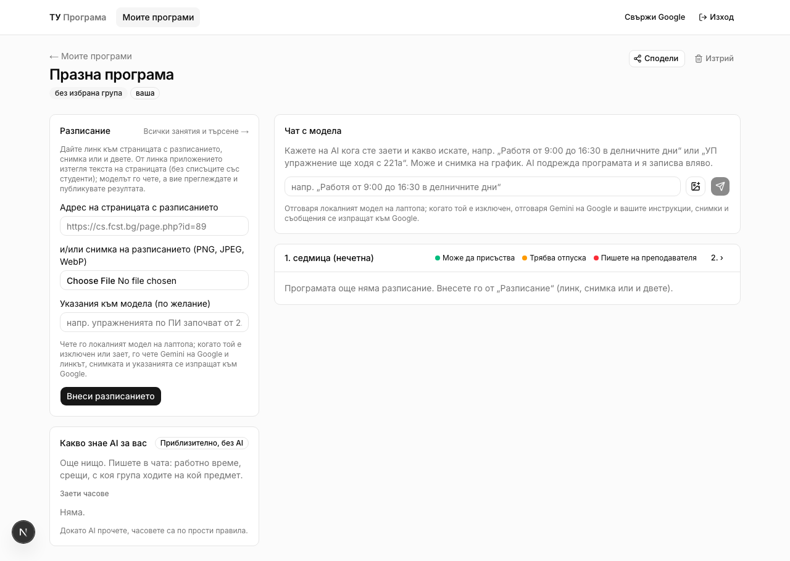
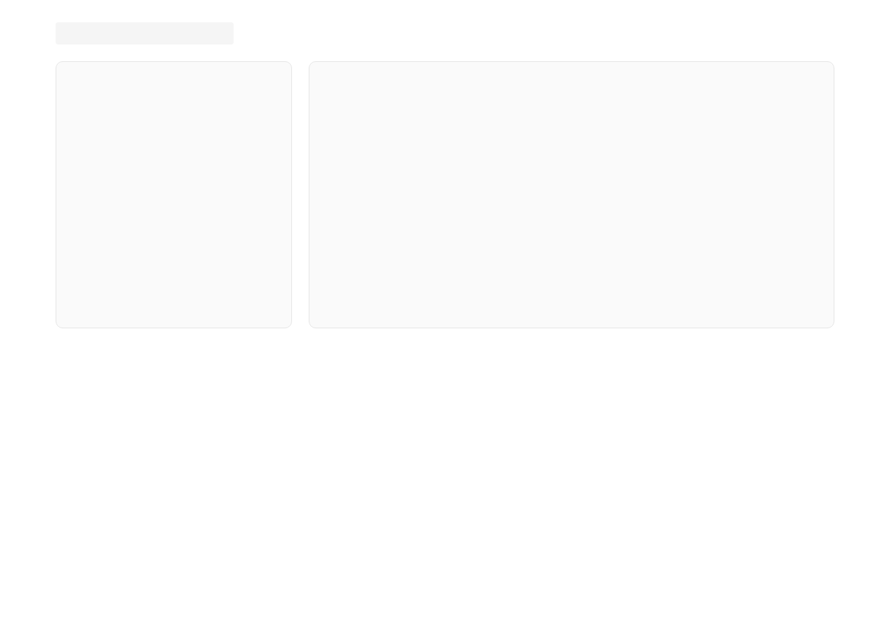
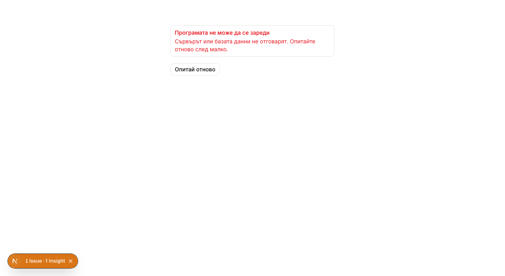
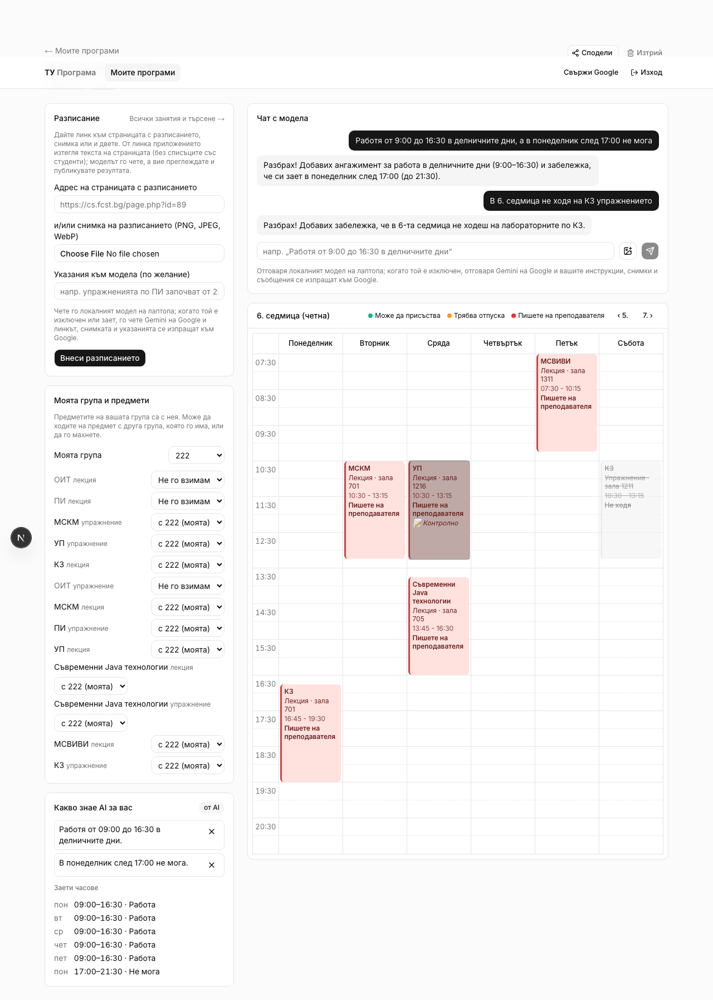
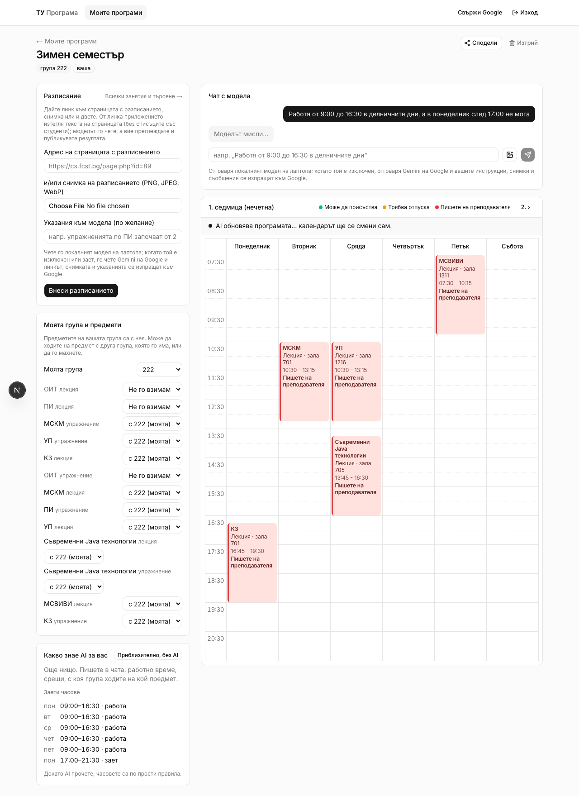
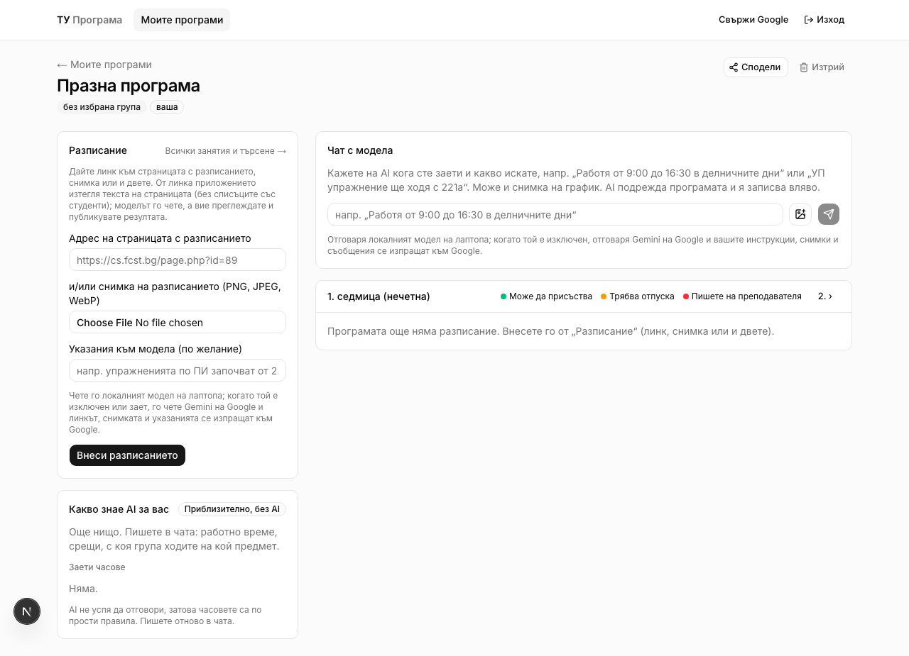
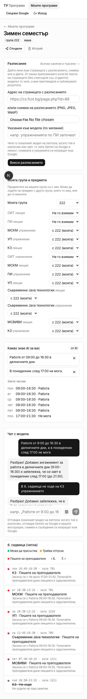
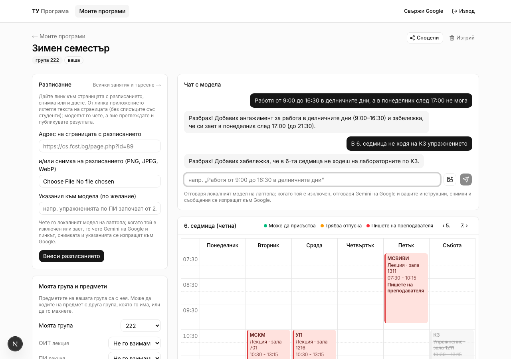

# UI checklist

<!-- Exercise 4 hands this in. Tick an item only when you have checked it, and replace
     the "how I checked" line with what you actually did. An unticked box is not a
     failure: it is a gap you then write into READINESS.md. A ticked box you cannot
     demonstrate at the defence is worse than an unticked one. -->

"Modern" is not a style. It is a short list of things a user notices when they are
missing: the screen tells you what is happening, you can get through it with a keyboard,
the text is readable, and nothing jumps around while it loads.

## Layout and typography

- [x] **One spacing scale and one type scale.** Sizes come from a small set of design tokens, not from numbers typed where they were needed.
  - how I checked: every size is a Tailwind step (`p-4`, `gap-6`, `text-sm`, `text-2xl`) and every colour a shadcn token in `app/globals.css` (`--background`, `--muted-foreground`, …); `grep -rn "px\]" app` finds no hand-typed pixel sizes in the screens.
- [x] **Responsive at 380, 768 and 1280 pixels wide.** No horizontal scrollbar, no text running under another element.
  - how I checked: a Playwright script opened the plan page at 380, 768 and 1280 px and compared `scrollWidth` with the window width: no horizontal scroll at any of them. Below 768 px the calendar becomes a list ([phone-380.png](ui/phone-380.png)).
- [x] **Nothing jumps while the page loads.** Images and cards reserve their space before their content arrives.
  - how I checked: a `PerformanceObserver` for `layout-shift` on the plan page measured a cumulative layout shift of 0.000; the loading skeleton has the same two columns as the page ([loading.png](ui/loading.png)).

## The four states, on every screen

A screen that only handles "it worked" is a screen that lies to the user on the day it matters.

- [x] **Loading.** Something tells the user the app is working, within about 100 ms.
  - how I checked: with the network slowed down in Playwright (2 s latency), opening a plan shows the skeleton from `app/plans/loading.tsx` at once ([loading.png](ui/loading.png)); buttons are disabled while their request runs.
- [x] **Empty.** The screen says what this list is for and what to do next, instead of showing nothing.
  - how I checked: a new account sees "Още нямате програма. Създайте първата отгоре." ([empty.png](ui/empty.png)); a plan with no timetable says how to import one, a plan with no group says to choose it.
- [x] **Error.** A sentence a person can read. Never a raw JSON body, never a stack trace, never just "Error".
  - how I checked: I stopped the database container and opened a plan: "Програмата не може да се зареди. Сървърът или базата данни не отговарят." with a retry button ([error.png](ui/error.png)); refused actions show the Bulgarian `{ "error" }` sentence next to the button.
- [x] **Success.** The user can see that what they did took effect, without reloading the page to find out.
  - how I checked: adding the note "Отменено" in the class dialog crosses the class out in the calendar at once ([success.png](ui/success.png)); choosing a subject's group moves the class in the calendar.

## Keyboard and accessibility

- [x] **The main flow works with the keyboard alone.** Sign in, do the core action, sign out, without touching the mouse.
  - how I checked: a Playwright script used only Tab, Space, Enter and typing to sign up, type a plan name, tick "start from the sample timetable" and create the plan. Calendar events are focusable and open their dialog with Enter; Escape closes it.
- [x] **The focused element is visible.** A `:focus-visible` outline that is not switched off.
  - how I checked: after tabbing into the plan name field, the field matches `:focus-visible` and has a 3 px ring (`box-shadow ... 0px 0px 0px 3px`) ([focus.png](ui/focus.png)).
- [x] **Text contrast is at least 4.5:1.** Name the tool you measured with.
  - how I checked: measured in the browser with the WCAG 2.1 relative-luminance formula (a Playwright script reading the computed colours): body text 19.8:1 and the grey secondary text 4.74:1 on the card background.
- [x] **Every input has a label** a screen reader reads, not just placeholder text.
  - how I checked: every field is inside a `<label>` or has an `aria-label` (search, chat, note, subject selects "Група за УП, упражнение"); the Playwright scripts find every field by its label, never by placeholder.
- [x] **The page has a correct `<title>` and `lang`.**
  - how I checked: `curl -s localhost:3000/signin` shows `<html lang="bg">` and `<title>Седмично разписание · ТУ София</title>`.
- [x] **Touch targets are at least 44 pixels.**
  - how I checked: on a touch device (Playwright `hasTouch`, 380 px) no button, select, text field or textarea is under 44 px tall; `app/globals.css` sets that minimum for `pointer: coarse`. Checkboxes are inside their `<label>`, so the whole label row is the target.

## The model feature

- [x] **It shows that it is thinking.** A model call is slow and a free service may have been asleep; a frozen button is the worst possible answer.
  - how I checked: after a chat message the chat shows "Моделът мисли…" and the page refreshes itself ([model-thinking.png](ui/model-thinking.png)); an import shows "в опашката", then "моделът чете".
- [x] **It shows when it failed,** and the rest of the screen still works.
  - how I checked: a timed-out import shows "Моделът не отговори навреме…" with "Опитай отново", and a failed plan says the busy times are computed without it, while the calendar still works ([model-failed.png](ui/model-failed.png)). With no worker for two minutes it says "Моделът е изключен в момента".
- [x] **The user can tell the model's suggestion from a fact.** It is labelled as a suggestion, not presented as data the app knows.
  - how I checked: the busy times carry "от AI" or "Приблизително, без AI"; an imported timetable is a draft until the student presses "Публикувай"; the labels in the calendar are the app's rule on those times, explained in the class dialog.

## Decisions

- [x] **Dark mode, or a written decision not to have one.**
  - what I decided and why: no dark mode switch. The colours are tokens with dark values already in `app/globals.css`, but the calendar's label colours were only checked on light; shipping an unchecked dark theme is worse than none.

## Evidence

Screenshots taken by Playwright against the running app on 2026-11-21:

